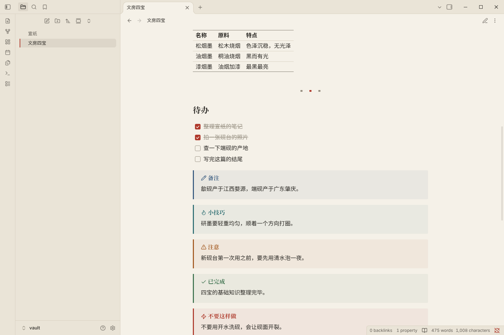

# 砚 Yan

一套为中文读写设计的 Obsidian 主题：宣纸为底，松烟墨为字，一点朱砂作印。

## 特点

- **两套配色**：亮色「宣纸」是暖白纸色配墨色文字，暗色「夜砚」是暖墨底配月白文字。全篇只用一种强调色（朱砂），而且用得很少。
- **中文排版**：标题用宋体，正文默认黑体；行距 1.8，每行约 42 个字。
- **朱砂印**：一级标题末尾盖一方小小的朱砂印。
- **楷体**：引用块用楷体，像书边的批注。斜体（`*强调*`）里的中文也改用楷体，避免中文被硬拉成歪斜的假斜体，英文仍然是斜体。
- **荧光笔高亮**：`==高亮==` 只涂文字的下半截，像用荧光笔划过。
- **书籍式表格**：没有竖线，只有上下两道粗线和表头下的一道细线。
- **分隔线**：`---` 显示为三方小印，中间一方是朱砂。
- **提示框**：用黛蓝、石青、赭石、竹青、朱砂、藤紫等传统色，底色只淡淡染一层。
- **中英文间距**：中文和英文之间自动留出一点空隙。这一条需要较新版本的 Obsidian，旧版本会自动忽略，不影响其他效果。

## 安装

1. 在你的库（vault）里找到 `.obsidian/themes/` 文件夹，在里面新建一个文件夹，名字必须是 `Yan`。
2. 把本仓库的 `theme.css` 和 `manifest.json` 两个文件放进 `Yan` 文件夹。
3. 打开 Obsidian「设置 → 外观 → 主题」，选择 **Yan**。

`.obsidian` 是隐藏文件夹。在 macOS 访达里按 `Cmd + Shift + .` 可以显示隐藏文件；在 Windows 资源管理器里，勾选「查看 → 隐藏的项目」。

## 可选设置

安装社区插件 **Style Settings** 之后，可以在它的设置页里找到「砚 Yan」，调整下面这些选项。不装这个插件也能完整使用主题，只是用默认值。

| 选项 | 可选值 | 默认 |
| --- | --- | --- |
| 正文字体 | 黑体 / 宋体 / 楷体 | 黑体 |
| 强调色 | 朱砂 / 黛蓝 / 竹青 | 朱砂 |
| 行宽 | 窄（约 36 字）/ 中（约 42 字）/ 宽（约 50 字） | 中 |
| 纸张纹理 | 开 / 关 | 关 |

行宽选项需要先在 Obsidian「设置 → 编辑器」里打开「缩减栏宽」。

如果你在 Obsidian「设置 → 外观 → 强调色」里自己选了颜色，会盖过主题的强调色。想恢复朱砂，把那里的颜色重置就行。

## 字体

主题不打包任何字体，会按顺序使用你电脑上已有的字体：

- **宋体**（标题）：思源宋体、Noto Serif CJK SC、macOS 自带的宋体-简、Windows 自带的宋体。
- **黑体**（正文、界面）：苹方、微软雅黑、思源黑体。
- **楷体**（引用、强调）：霞鹜文楷、macOS 的楷体-简（可能要先在「字体册」里下载）、Windows 自带的楷体。
- **等宽**（代码）：JetBrains Mono、更纱黑体等宽。

想要最好的效果，推荐装上免费的 [霞鹜文楷](https://github.com/lxgw/LxgwWenKai) 和 [思源宋体](https://github.com/adobe-fonts/source-han-serif)。在 Obsidian「设置 → 外观 → 字体」里单独指定的字体，优先级高于主题。

## 兼容性

需要 Obsidian 1.5 或更新版本，已在 1.14.4 的桌面版上测试过亮色和暗色模式、阅读视图和实时预览。
