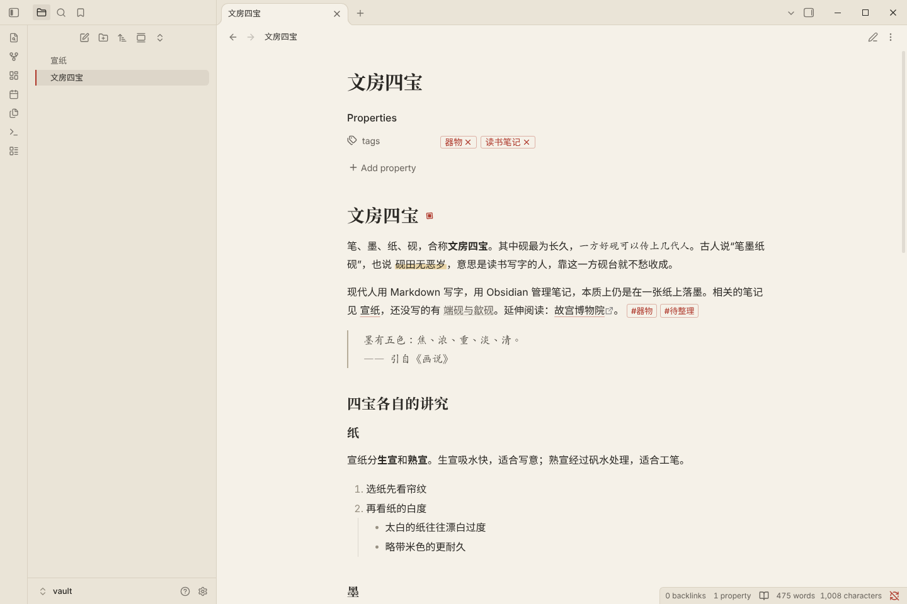
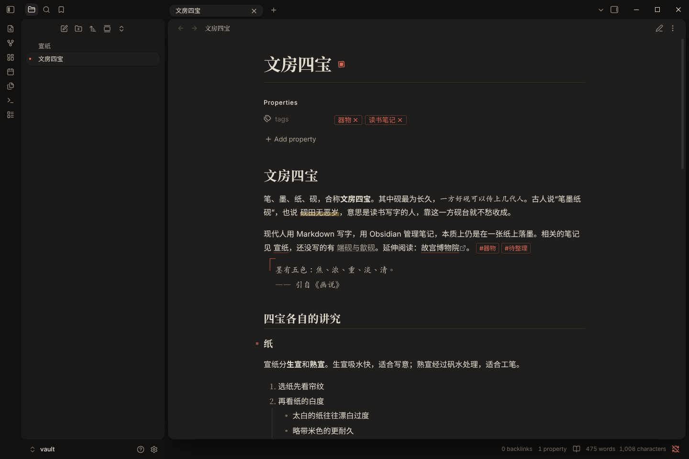
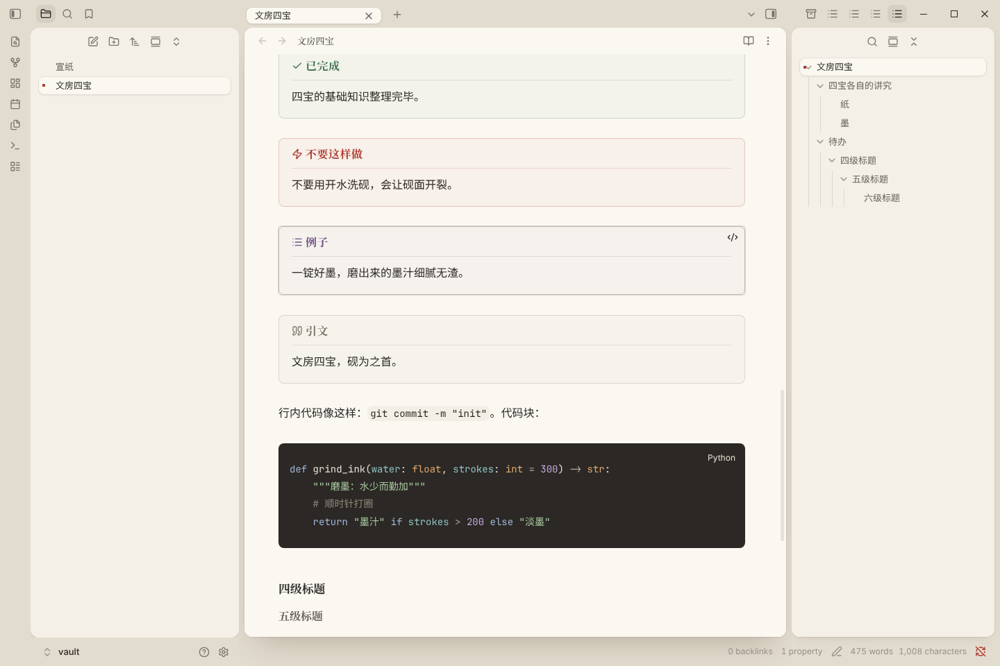
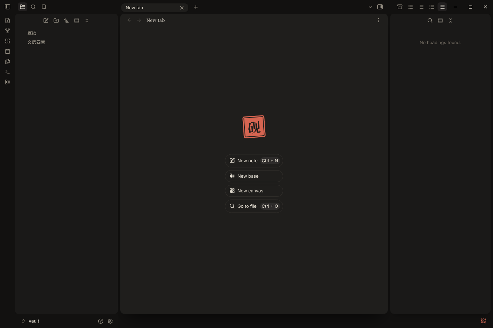
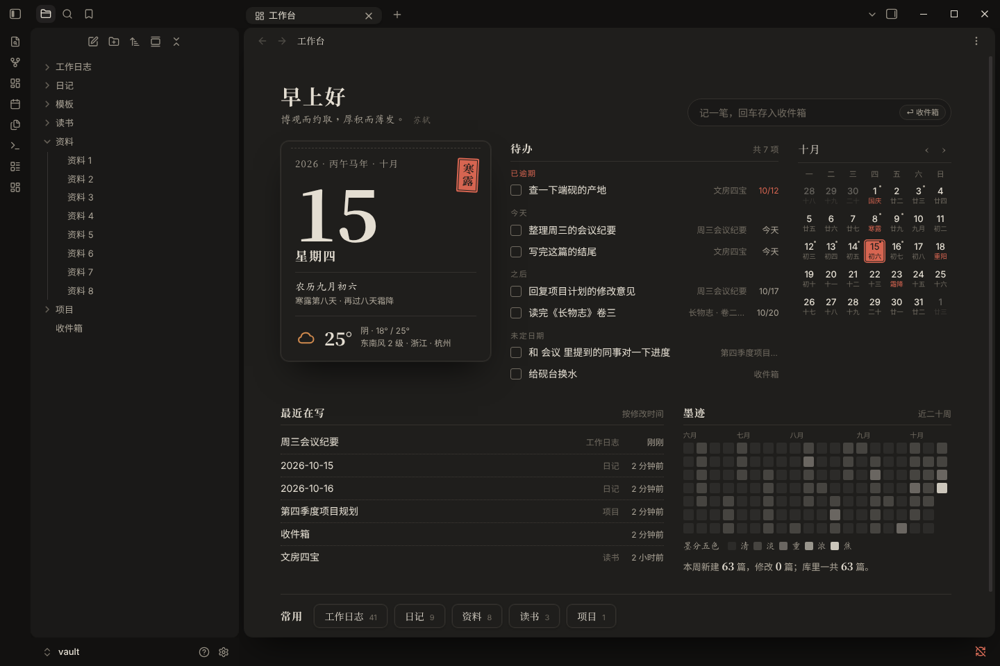
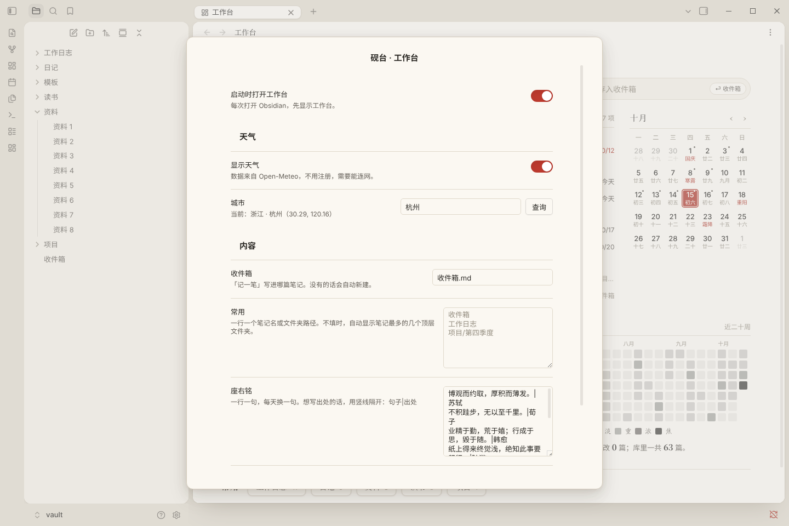

# 砚 Yan

一套为中文读写设计的 Obsidian 主题。整个窗口是一张书案，侧边栏和笔记是放在案上的几张纸；松烟墨为字，一点朱砂作印。

仓库里有三样东西，可以只用其中一样，也可以一起用：

| 内容 | 位置 | 作用 |
| --- | --- | --- |
| 主题「砚」 | `theme.css`、`manifest.json` | 整个 Obsidian 的外观 |
| 工作台插件「砚台」 | `yan-desk/` | 打开 Obsidian 先看到的工作台：日签、天气、待办、月历等 |
| 公文排版片段 | `snippets/word-style.css` | 一键把笔记切换成公文字体排版 |





## 一键安装（Windows）

1. 在 GitHub 上点「Code → Download ZIP」下载本仓库，**整个解压**出来（不要在压缩包里直接双击）。
2. 先完全退出 Obsidian。
3. 双击解压出来的 `一键安装（Windows）.bat`。如果 Windows 弹出安全提示，选「运行」；如果提示「Windows 已保护你的电脑」，点「更多信息 → 仍要运行」。
4. 窗口里会列出电脑上的笔记库，输入序号后回车；再输入城市名（用于天气，可以直接回车跳过）。
5. 打开 Obsidian。弹出「你是否信任这个仓库的作者？」时，点「信任仓库作者并启用插件」，工作台就出来了。

安装程序会做这些事：把主题、工作台插件和公文排版片段放进所选笔记库的 `.obsidian` 文件夹；把主题设成「砚」；把工作台加进已启用的插件。原来的外观设置和其他插件都保留，公文排版片段只放好、不打开。以后有新版本，再运行一次就是升级，工作台的设置不会丢。

Mac 或者想手动装的话，按下面各部分里的「安装」步骤来。

## 特点

**书案布局**

- **岛台式界面**：左侧文件栏、中间笔记、右侧大纲各是一张独立的圆角纸，悬浮在书案上，彼此之间留一道缝。笔记那张纸最白、投影最深，一眼就能分清主次。
- **界面收敛**：标签页是书案上的小纸签；当前文件像一张浮起的纸签，左边有一方朱砂小印；底部状态栏和左下角的库名排成一条。
- **空白页**：新开一个空白标签页时，正中盖一方刻着「砚」字的朱砂印。
- 不喜欢悬浮效果，可以在设置里换成平铺布局。手机上始终是平铺的。

**排版**

- **两套配色**：亮色「宣纸」是暖白纸色配墨色文字，书案是偏灰的砚石色；暗色「夜砚」是深墨灰的纸放在近黑的书案上。全篇只用一种强调色（朱砂），而且用得很少。
- **题目页**：笔记标题用大号宋体，下面一道细线，末尾盖一方朱砂印。
- **标题层次**：标题全用宋体。二级标题下拉一道贯穿的细线，像书里的章节分隔；三级标题左边悬着一个小方点。
- **中文排版**：正文默认黑体，行距 1.8，每行约 42 个字。
- **楷体**：引用用楷体，左上角一个淡朱砂色的大「。斜体（`*强调*`）里的中文也改用楷体，避免中文被硬拉成歪斜的假斜体，英文仍然是斜体。
- **荧光笔高亮**：`==高亮==` 只涂文字的下半截，像用荧光笔划过。
- **提示框**：像博物馆的展签，细边框、很淡的底色，标题下一道细线；用黛蓝、石青、赭石、竹青、朱砂、藤紫等传统色。
- **代码块**：一块深色的砚面，亮色模式下也是深色；阅读视图里右上角会写出是哪种语言。
- **书籍式表格**：没有竖线，只有上下两道粗线和表头下的一道细线。
- **分隔线**：`---` 显示为三方小印，中间一方是朱砂。
- **有序列表**：序号用宋体。
- **中英文间距**：中文和英文之间自动留出一点空隙。这一条需要较新版本的 Obsidian，旧版本会自动忽略，不影响其他效果。





## 工作台「砚台」


一个配套的小插件。每次打开 Obsidian，先显示这一页：

- **日签**：大号日期、星期、农历、节气进度；右上角的朱砂印刻着当前节气；底部是天气。点一下打开今天的日记。
- **记一笔**：输入后按回车，写进「收件箱」笔记并带上时间；按 Ctrl + 回车（Mac 上是 Cmd + 回车）存成一条待办。
- **待办**：汇总全库还没打勾的事项，按"已逾期 / 今天 / 之后 / 未定日期"分组。点方框就能勾掉，结果写回原笔记；点文字跳到那一行。到期日按 Tasks 插件的写法识别：`- [ ] 写周报 📅 2026-10-20`。
- **月历**：每格写着农历日、节气或节日；有日记的日子右上角有个小墨点；今天是一方朱砂印。点哪天就打开哪天的日记，还没有的会先问一句再新建（会用「日记」核心插件里设的文件夹、格式和模板）。
- **最近在写**：最近修改的六篇笔记。
- **墨迹**：近二十周每天新建和修改的笔记数，深浅分「清、淡、重、浓、焦」五档。Obsidian 只记录每篇笔记的创建时间和最后修改时间，所以这张图是估算，不是完整的写作记录。
- **常用**：你指定的笔记或文件夹；不指定时，自动列出笔记最多的几个顶层文件夹。

天气来自 [Open-Meteo](https://open-meteo.com)，不用注册，但需要能连网；连不上时显示上一次的数据，或者提示稍后再试，其他部分不受影响。



### 安装工作台

1. 在库里的 `.obsidian/plugins/` 文件夹下新建一个文件夹，名字必须是 `yan-desk`。
2. 把本仓库 `yan-desk/` 里的 `manifest.json`、`main.js`、`styles.css` 三个文件放进去。
3. 打开 Obsidian「设置 → 第三方插件」，点「退出受限模式」（旧版本里是关闭「安全模式」），然后在「已安装插件」里打开「砚台 · 工作台」。
4. 在「砚台 · 工作台」的设置里填上城市，点「查询」。

插件设置：



| 设置 | 说明 |
| --- | --- |
| 启动时打开工作台 | 默认打开。关掉后，可以点左侧图标栏的工作台按钮，或者在命令面板里运行「打开工作台」 |
| 显示天气、城市 | 填城市名后点「查询」；不想显示天气就关掉 |
| 收件箱 | 「记一笔」写进哪篇笔记，默认 `收件箱.md` |
| 常用 | 一行一个笔记名或文件夹路径 |
| 座右铭 | 一行一句，每天换一句；写出处用竖线隔开：`句子\|出处` |
| 不统计的文件夹 | 这些文件夹里的笔记不出现在待办、最近在写和墨迹里；模板文件夹会自动排除 |

## 公文排版片段

`snippets/word-style.css` 把笔记换成公文字体：标题方正小标宋，二级标题黑体，三级标题楷体，正文仿宋。写正式材料时打开，平时关掉。

1. 把 `word-style.css` 放进库里的 `.obsidian/snippets/` 文件夹。
2. 打开「设置 → 外观 → CSS 样式代码片段」，点「重新加载样式代码片段」按钮，然后打开 `word-style`。

需要电脑上装有方正小标宋简体、仿宋_GB2312、楷体_GB2312 这些字体；没有的话会退回系统自带的仿宋和楷体。

## 安装主题

1. 在你的库（vault）里找到 `.obsidian/themes/` 文件夹，在里面新建一个文件夹，名字必须是 `Yan`。
2. 把本仓库的 `theme.css` 和 `manifest.json` 两个文件放进 `Yan` 文件夹。
3. 打开 Obsidian「设置 → 外观 → 主题」，选择 **Yan**。

`.obsidian` 是隐藏文件夹。在 macOS 访达里按 `Cmd + Shift + .` 可以显示隐藏文件；在 Windows 资源管理器里，勾选「查看 → 隐藏的项目」。

## 可选设置

安装社区插件 **Style Settings** 之后，可以在它的设置页里找到「砚 Yan」，调整下面这些选项。不装这个插件也能完整使用主题，只是用默认值。

| 选项 | 可选值 | 默认 |
| --- | --- | --- |
| 平铺布局 | 开 / 关 | 关（即使用书案布局） |
| 正文字体 | 黑体 / 宋体 / 楷体 | 黑体 |
| 强调色 | 朱砂 / 黛蓝 / 竹青 | 朱砂 |
| 行宽 | 窄（约 36 字）/ 中（约 42 字）/ 宽（约 50 字） | 中 |
| 纸张纹理 | 开 / 关 | 关 |

行宽选项需要先在 Obsidian「设置 → 编辑器」里打开「限制行宽」。

如果你在 Obsidian「设置 → 外观 → 主题色」里自己选了颜色，会盖过主题的强调色。想恢复朱砂，把那里的颜色重置就行。

## 字体

主题不打包任何字体，会按顺序使用你电脑上已有的字体：

- **宋体**（标题）：思源宋体、Noto Serif CJK SC、macOS 自带的宋体-简、Windows 自带的宋体。
- **黑体**（正文、界面）：苹方、微软雅黑、思源黑体。
- **楷体**（引用、强调）：霞鹜文楷、macOS 的楷体-简（可能要先在「字体册」里下载）、Windows 自带的楷体。
- **等宽**（代码）：JetBrains Mono、更纱黑体等宽。

想要最好的效果，推荐装上免费的 [霞鹜文楷](https://github.com/lxgw/LxgwWenKai) 和 [思源宋体](https://github.com/adobe-fonts/source-han-serif)。在 Obsidian「设置 → 外观 → 字体」里单独指定的字体，优先级高于主题。

## 兼容性

需要 Obsidian 1.5 或更新版本。主题和工作台都在 1.14.4 的桌面版上实际测试过：亮色和暗色模式、阅读视图和实时预览、左右侧边栏同时打开、窄窗口、重启后自动打开工作台。手机端还没有实际测试过。

## 开发

工作台里日期、农历、节气、待办解析这些计算部分有单元测试，在仓库根目录运行：

```bash
node --test
```
